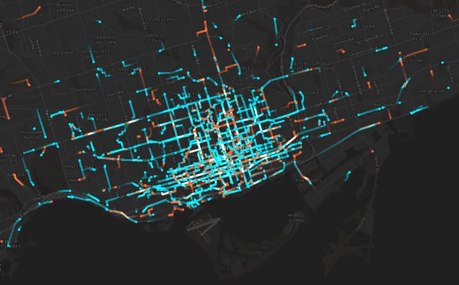
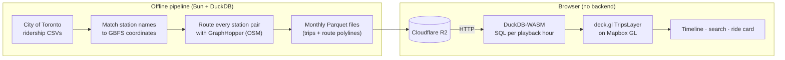

# Toronto Bike Share Flow Map

An animated map that replays real Bike Share Toronto rides, street by street, at the time they happened.
Jump to an hour from 2017 to early 2026, watch the city move, or pick a single ride and follow it from dock to dock.

**[Live demo →](https://antoniamugisa.com/projects/bike-share-toronto#bike-share-demo)**



- **23+ million rides** across 107 months (January 2017 to February 2026; October–December 2024 aren't in the City's data), from City of Toronto open data
- **~370,000 station-to-station routes**, each one routed along real streets
- **No backend.** The browser queries the trip data directly with DuckDB-WASM and draws it on the GPU with deck.gl

## What you can do

- **Watch the city move.** Rides animate along their routes, cyan for members and orange for casual riders.
  A timeline shows rides per hour for the day; click any hour to jump to it, and play at 1×, 2× or 4×.
- **Jump to a moment.** Type a time (`July 1, 2025 10pm`) or pick one: weekday rush, Canada Day night, the Pride Parade.
- **Find a real ride.** Pick a start station and see the rides that left it around that time. Choose one and the map
  follows it, with a live status ("Riding · 9 min to go"), distance and speed.
- **Share a moment.** The address bar always points at the hour you're watching, and the link button copies the
  exact minute (and the ride you're following), e.g. `?t=2025-07-01T22:00&ride=…`.
- **See who's riding.** A panel shows the member/casual and classic/e-bike split for the hour, the typical ride length,
  and the busiest start station. On Canada Day 2025 at 10pm that was the dock by the fireworks.

## Architecture



### 1. Data pipeline (offline)

The pipeline lives in [`pipeline/`](../../../pipeline) and runs once per data refresh. Its README covers the full setup.

1. **Download.** Every year of ridership data comes from the City's CKAN API. The CSV format has changed many times
   (day-first dates in 2017, two-digit years, three different user-type vocabularies, two bike-model columns), and the
   pipeline handles each era.
2. **Stations.** Each station name in the trips is matched to today's live GBFS feed for coordinates. Stations within
   60 m of each other are merged into one canonical station.
3. **Routes.** Every start/end pair that appears in the trips is routed with a self-hosted
   [GraphHopper](https://www.graphhopper.com/) server on OpenStreetMap data. The bike profile caps speed at 15 km/h and
   avoids motorways. Routes are cached in SQLite, so the multi-hour run can stop and resume. A round trip is drawn as
   a loop out to the nearest station and back.
4. **Parquet.** Trips are joined to their routes and written as one ZSTD-compressed Parquet file per Toronto calendar
   month. Times are converted from Toronto local time to UTC.

### 2. Storage

The monthly Parquet files (467 MB across the published months) sit in a public Cloudflare R2 bucket.
In development, Vite proxies them so DuckDB isn't blocked by CORS.

### 3. In the browser

- **First frame.** The demo opens on a July 2024 weekday rush hour. That hour ships as a static JSON file
  ([`firstHour.ts`](firstHour.ts)), so ~3,800 rides draw without waiting for DuckDB-WASM, which loads in the background.
  On the live site, the first ride now appears about 6 s after page load instead of 17.5 s; the demo's own part went
  from about 14 s to 2 s.
- **Query.** [`useTripStream.ts`](useTripStream.ts) registers each month as a DuckDB-WASM view over its Parquet file and
  runs one SQL query per playback hour. A real day-hour loads every ride (up to 6,000); the month-wide default view
  overlays that hour from every day of the month and samples 1,800.
- **Prefetch.** At 20% through an hour, the next hour is queried in the background, so the roll-over is seamless.
- **Render.** [`MapView.tsx`](MapView.tsx) draws rides with deck.gl's `TripsLayer` on a Mapbox basemap. The animation
  loop runs outside React (refs and `requestAnimationFrame`), so the UI doesn't re-render every frame. Timestamps are
  stored relative to the playback hour because the GPU uses 32-bit floats, which can't hold epoch milliseconds precisely.
- **Search.** [`ExploreSheet.tsx`](ExploreSheet.tsx) parses free-text times
  ([`parseTimeTravelQuery.ts`](parseTimeTravelQuery.ts)), ranks stations by rides that month, and lists real rides from
  a station with SQL ([`queries.ts`](queries.ts)).

## A data bug worth telling

While building the "follow a ride" feature, every 2025 ride came back as a round trip. The City's 2025 CSVs repeat
the **start** station's name in the `End_Station_Name` column on every row (7 million of them), while `End_Station_Id`
is correct:

```
Start_Station_Id,Start_Station_Name,       End_Station_Id,End_Station_Name
7267,            Dundas St E / Pembroke St, 7021,          Dundas St E / Pembroke St
```

The pipeline now ignores that column for modern files and resolves each end station from its ID, using the name that
ID has as a start station in the same file. That brought the round-trip share from 100% back to a normal 2–3%, and
meant routing about 90,000 station pairs that had never been seen before.

## Code map

| File | What it does |
|---|---|
| [`page.tsx`](page.tsx) | Playback state, keyboard shortcuts, wires the pieces together |
| [`MapView.tsx`](MapView.tsx) | Mapbox + deck.gl layers and the animation loop |
| [`useTripStream.ts`](useTripStream.ts) | DuckDB-WASM setup, per-hour queries, caching and prefetch |
| [`queries.ts`](queries.ts) | SQL for station counts, hourly counts and ride search |
| [`TimelineDock.tsx`](TimelineDock.tsx) | Rides-per-hour timeline and playback controls |
| [`ExploreSheet.tsx`](ExploreSheet.tsx) | Time travel and Find a ride |
| [`RidesPanel.tsx`](RidesPanel.tsx) | Riding-now count and the hour's rider split |
| [`TripCard.tsx`](TripCard.tsx) | The followed ride's details and live status |
| [`firstHour.ts`](firstHour.ts) | The opening hour, loaded from a static file |
| [`shareLink.ts`](shareLink.ts) | Reading and writing `?t=…&ride=…` links |
| [`torontoTime.ts`](torontoTime.ts) | Toronto wall-clock ↔ UTC, DST-safe |

## Running it locally

From the repo root:

```bash
npm install
echo "VITE_MAPBOX_TOKEN=<your Mapbox token>" >> .env.local
npm run dev
```

Then open `/projects/bike-share-toronto` and press **Live Demo**. The Parquet files are read from the public bucket,
so you don't need to run the pipeline.

## Known limits

- **Older years keep fewer rides** (about a third to just over half for 2017–2023), because renamed or removed stations can't be
  matched to today's station coordinates.
- **2023–2024 label most riders casual.** That's how the source data is labelled, not a pipeline bug.
- **Routes are estimates.** Rides are drawn along the likeliest cycling route between two stations; the data has no GPS.

## Data and credits

- Trips: [Bike Share Toronto Ridership Data](https://open.toronto.ca/dataset/bike-share-toronto-ridership-data/),
  City of Toronto, under the Open Government Licence – Toronto
- Station coordinates: Bike Share Toronto GBFS feed
- Street network: © OpenStreetMap contributors (ODbL), routed with GraphHopper
- Inspired by [bikemap.nyc](https://github.com/freeman-jiang/bikemap.nyc)
